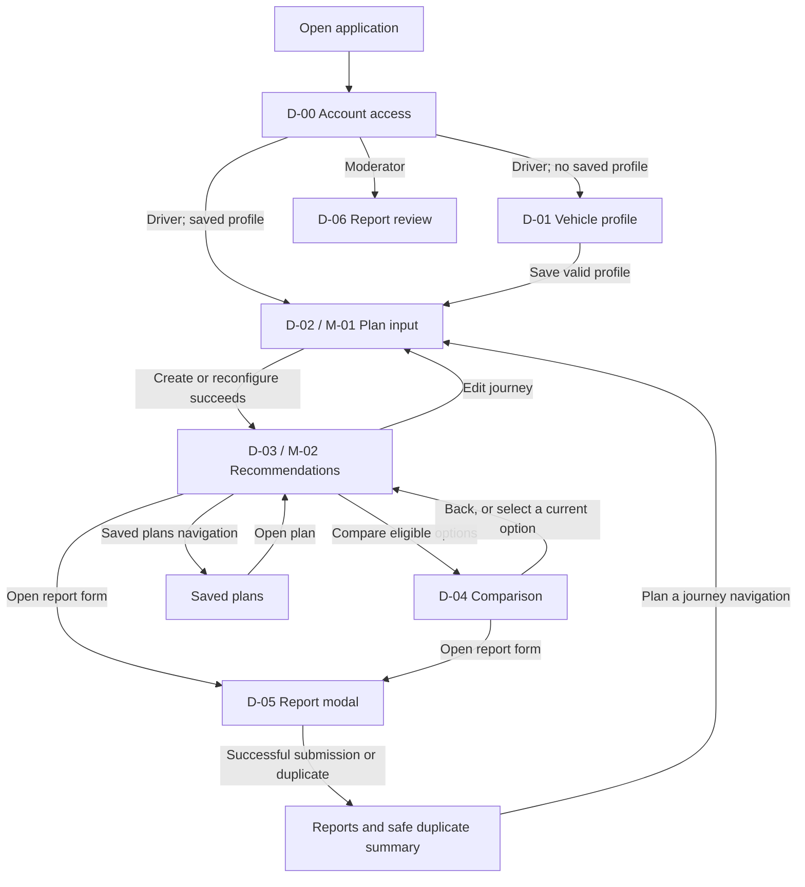
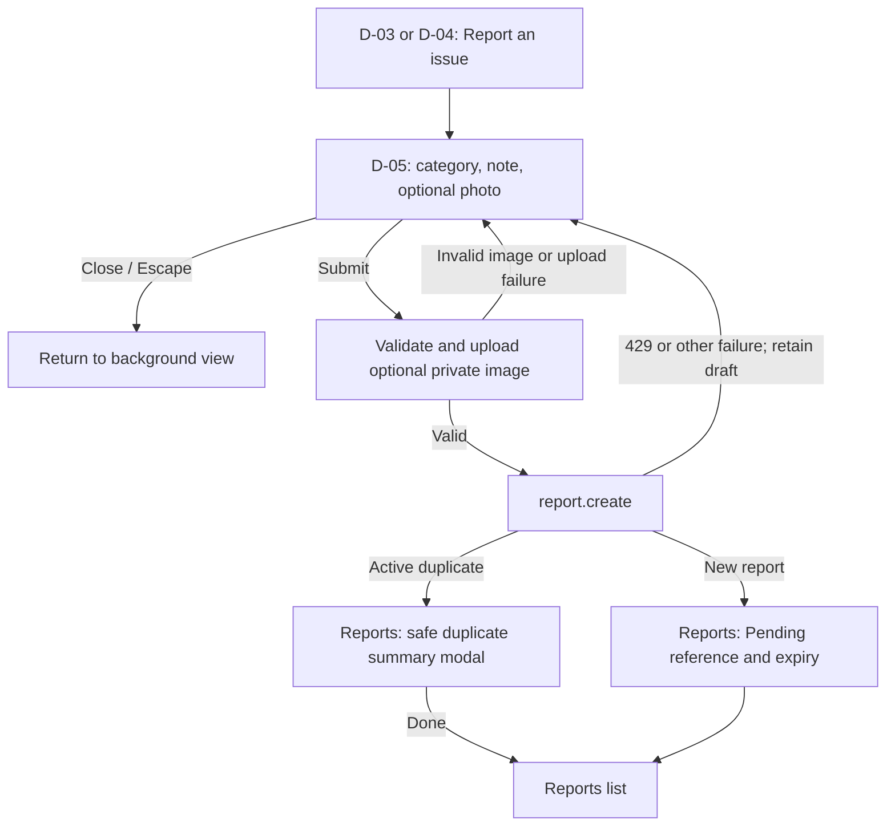
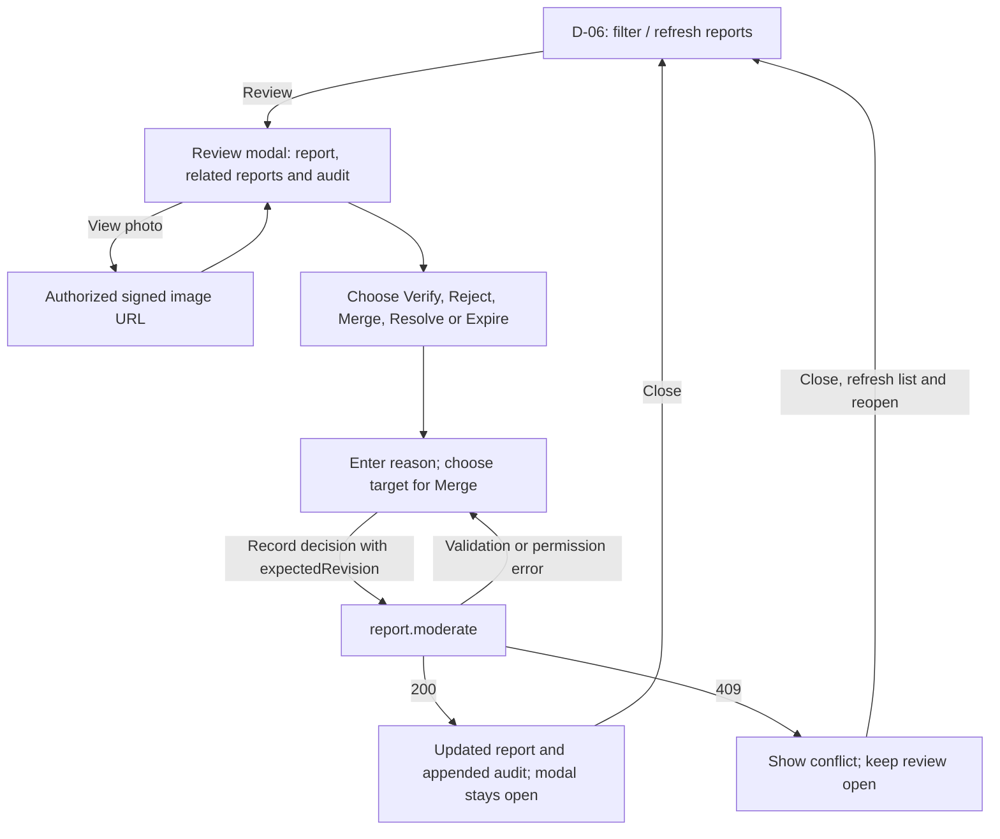

# PlugPlan SG - Refined Dialog Map

SC2006 Software Engineering | Team SCE3-04 | Lab 3 | 25 October 2026

## 1. Frames and interaction model

The dialog map refines the Lab 2 screen flow into events, guards, actions and recovery states. Screen identifiers remain consistent across the use cases and design model.

| Frame | UI state / boundary | Responsibility |
|---|---|---|
| D-00 | `AuthScreen` | Email/password sign-in and Driver registration |
| D-01 | `view = vehicle` | Create, update or confirm-delete one EV profile |
| D-02 / M-01 | `view = plan`; `PlacePicker` | Journey inputs, explicit Live/Demo mode and reconfiguration |
| D-03 / M-02 | `view = results`; `JourneyMap` | Ranked recommendations, selection, versions and manual refresh |
| D-04 | `view = compare` | Compare two or three options using the same metrics |
| D-05 | `reportContext`; `Modal` | Charger issue form; duplicate summary is a separate overlay |
| D-06 | `view = moderator`; `selectedReport` | Moderator list, evidence, decision form and audit history |
| Saved plans | `view = saved` | Open a saved plan or confirm-delete it and its versions |
| Reports | `view = reports` | Driver-owned reports; all reports for a Moderator |

M-01 and M-02 are responsive renderings of D-02 and D-03 with the same actions and validation. The mobile workspace uses bottom navigation. Dialogs support keyboard focus and dismissal. Unsaved profile/journey edits trigger a discard confirmation when leaving.

## 2. Workspace navigation

Driver navigation also gives direct access to Vehicle, Plan, Saved plans and Reports. Moderator navigation offers Report review and All reports. A retained session is restored at startup; the persisted `app_users.role` selects the workspace. Sign-out revokes the current application session, signs out through Supabase and returns to D-00.

## 3. Planning, comparison and refresh transitions

| ID | Source and event | Guard / action | Destination |
|---|---|---|---|
| T-01 | D-00: sign in / register | Supabase Auth validates credentials; `bootstrap` loads role, profile, plans and reports. Public registration creates a Driver. | D-01, D-02 or D-06 according to role/profile |
| T-02 | Any workspace: sign out | Confirm if edits are unsaved; call `session.logout`, then local SDK sign-out. | D-00 |
| T-03 | D-01: save vehicle | Validate field ranges server-side; call `profile.save`; update the saved profile. | D-02 |
| T-04 | D-01: delete vehicle | Confirm; call `profile.delete`; reset form defaults. Historical versions retain copied assumptions. | D-01, no active profile |
| T-05 | D-02: search/select place | `places.search` returns candidates in the chosen data mode; selection stores label and coordinates in the draft. | D-02, selected place |
| T-06 | D-02: calculate | Both places selected and a profile saved; validate inputs; call `plan.create`, or `plan.reconfigure` when editing a saved plan. | D-03, newly saved version |
| T-07 | D-02: invalid input / provider failure | Show field or provider error and retain draft; no partial version is stored. | D-02, correction/retry |
| T-08 | D-03: compare | At least two recommendations. With no checkboxes selected, compare all available options; otherwise select two or three. | D-04 |
| T-09 | D-03/D-04: choose stop | Viewing current version; call `plan.select`. Update the plan's selection pointer; do not create a version. | D-03, selected option |
| T-10 | D-03: edit / change strategy | Edit copies inputs into D-02; a strategy tab submits `plan.reconfigure` directly. | D-02, or D-03 with new version |
| T-11 | D-03: change version | Load the chosen immutable result; historical views disable selecting a stop. | D-03/D-04, historical evidence |
| T-12 | D-03: refresh | Call `plan.refresh`; recalculate current inputs with latest usable evidence and active verified faults. | D-03, new version |
| T-13 | Refresh: selected option remains eligible | Preserve the selection. | D-03, same choice in new result |
| T-14 | Refresh: selected option disappears | Clear selection, explain the reason and identify the next ranked option. Driver selects explicitly using T-09. | D-03, fallback offered |
| T-15 | Refresh: no fallback / provider failure | No fallback: save an explicit empty result. Failed refresh: preserve the previous version and display the error. | D-03, explanatory state |
| T-16 | Saved plans: open / delete | Open selects the current version; delete requires confirmation and removes the plan and its versions. | D-03 / Saved plans |
| T-17 | Leave a dirty profile/journey | Confirm discarding edits; cancellation keeps the current draft. | Requested view / original view |

Only creation, reconfiguration and successful refresh append Plan Versions. Selecting a recommendation changes mutable plan state. A successful recalculation ranks feasible candidates, removes stations supported by active verified suspected-fault reports, then forms a shortlist of up to three. Pending reports do not exclude stations.

## 4. Issue-report dialog

| ID | Event / state | Behavior |
|---|---|---|
| T-18 | Open D-05 | Prefill station/connector context; reset note/photo; show privacy guidance and operator support link when known. |
| T-19 | Choose photo | Accept JPEG, PNG or WebP, at most 5 MiB; retain the form when validation/upload fails. |
| T-20 | Submit | UI requires a 5-2,000 character note. Upload any image to the owner folder in private `issue-images`, then call `report.create`. |
| T-21 | New report | Close form, open Reports, acknowledge `PENDING` and default 24-hour expiry. |
| T-22 | Duplicate | Show reference, target, category, status and expiry; another reporter's identity, notes and images remain private. |
| T-23 | Rate limited | Keep draft; display the allowed-again time in SGT from API `retryAfter`. |
| T-24 | View report evidence | `report.image-url` returns a short-lived URL only to an authorized report reader. |

## 5. Moderator dialog

| ID | Event / state | Behavior |
|---|---|---|
| T-25 | Filter / refresh | Filter by report lifecycle state; refreshing calls `reports.list`. |
| T-26 | Review | Inspect note, optional photo, related reports, cached official LTA status and decision history. Official detail retrieval and batch source times are labelled. |
| T-27 | Record decision | Send `reportId`, `moderationAction`, `reason`, `expectedRevision` and optional `mergeTargetId`. UI reason length is 3-500 characters; the server requires a nonblank trimmed reason, at most 500. |
| T-28 | Destructive decision | Reject, Merge, Resolve and Expire request confirmation; Merge requires a valid canonical target. |
| T-29 | Successful decision | Update the report/revision and audit in the open modal; clear the reason field. |
| T-30 | Revision conflict | HTTP 409 leaves the review open with an error. Close, refresh and reopen to review current data before resubmitting. |

Only verified, unexpired `SUSPECTED_FAULTY_CONNECTOR` reports support station exclusion. Resolve/expiry removes that report's support; another active support can keep the station excluded. Merge retains the canonical report. These changes affect subsequent calculations and refreshes; saved versions remain historical evidence.

## 6. UI callouts and design decisions

| Area | Controls and constraints |
|---|---|
| Account access | Email/password form; registration requires at least 10 characters including a letter and number. Busy controls prevent repeat submission. Errors remain generic. |
| EV profile | Capacity 10-250 kWh; consumption 5-50 kWh/100 km; AC limit 1-50 kW; DC limit 1-400 kW; reserve 5-40% (default 20%); detour 0-120 min; one or more compatible plugs. |
| Plan input | SOC 0-100%; charging window 5-720 min; detour 0-120 min; optional manual target 0-100%. OneMap suggestions support keyboard selection. Times use SGT unless an explicit offset is supplied. |
| Strategies | Balanced, Fastest journey, Cheapest charging, Availability first and Minimum detour. Cheapest uses supported total charging cost; Fastest uses total journey time. |
| Results / comparison | Shared units and assumptions, source and observed/retrieved times, explicit zero/one-result states, unknown price labelled `Price unavailable`, up to three compared options. |
| Data states | LIVE is fresh fetched evidence; CACHED is usable cached evidence; at 10 minutes or older, relevant source/detail evidence is STALE. DEMO_FIXTURE is explicitly selected synthetic data. |
| Map | Leaflet uses OneMap tiles and decoded route geometry when supplied; markers represent origin, destination and charging recommendations. |
| Access control | Browser session uses the Supabase JS client. API requests carry a bearer JWT; `requireUser` checks identity, active session and persisted application role. Driver/Moderator gates and database RLS protect operations. |
| Persistence | `vehicles`, `plans`, `plan_versions`, `issue_reports` and `moderation_decisions` store owned data; version creation and moderation use transactional RPCs. |
| Transient data | Unsaved location/profile drafts and modal fields stay in component state. Reload resets unsaved drafts; version inputs are retained only after saving a plan. |
| Provider failure | Server provider calls share a roughly 3.9-second deadline. Usable station and compatible route caches may support a labelled degraded result; otherwise show an explicit error and retain the draft/previous version. |

## 7. Traceability

| Use case | Frames | Main design collaborators |
|---|---|---|
| UC-01 Account access | D-00; role-specific landing | AuthScreen, ApiClient, AuthGuard, BootstrapRepository |
| UC-02 EV profile | D-01 | PlugPlanApp, ValidationSchemas, ProfileRepository |
| UC-03 Create plan | D-02/D-03; M-01/M-02 | PlacePicker, ServiceHandler, ProviderGateway, PlanEngine, PlanRepository |
| UC-04 Review/compare | D-03/D-04; Saved plans | PlugPlanApp, JourneyMap, PlanRepository |
| UC-05 Reconfigure | D-02/D-03 | ServiceHandler, PlanEngine, PlanRepository |
| UC-06 Refresh/fallback | D-03; M-02 | ProviderGateway, PlanEngine, ReportRepository, PlanRepository |
| UC-07 Issue report | D-05; Reports | PlugPlanApp, Modal, ReportRepository, Supabase Storage |
| UC-08 Moderation | D-06 | PlugPlanApp, AuthGuard, ReportRepository, ModerationDecision |
