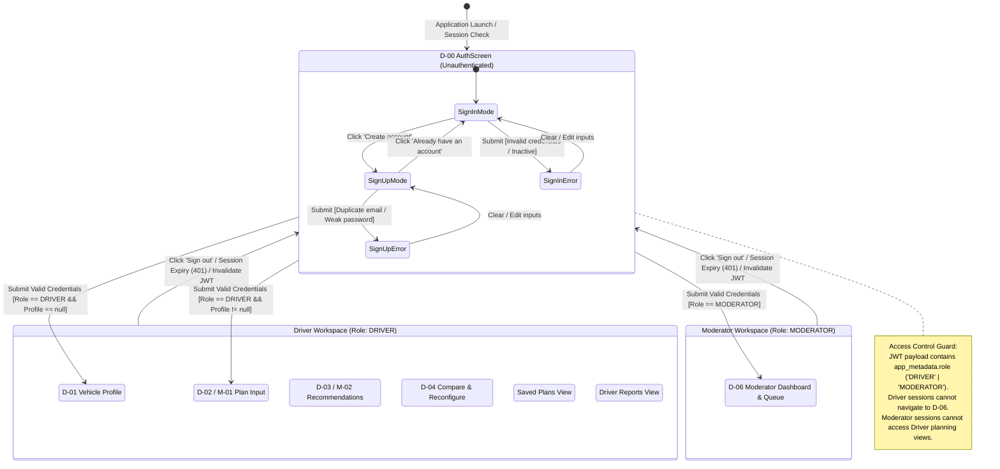
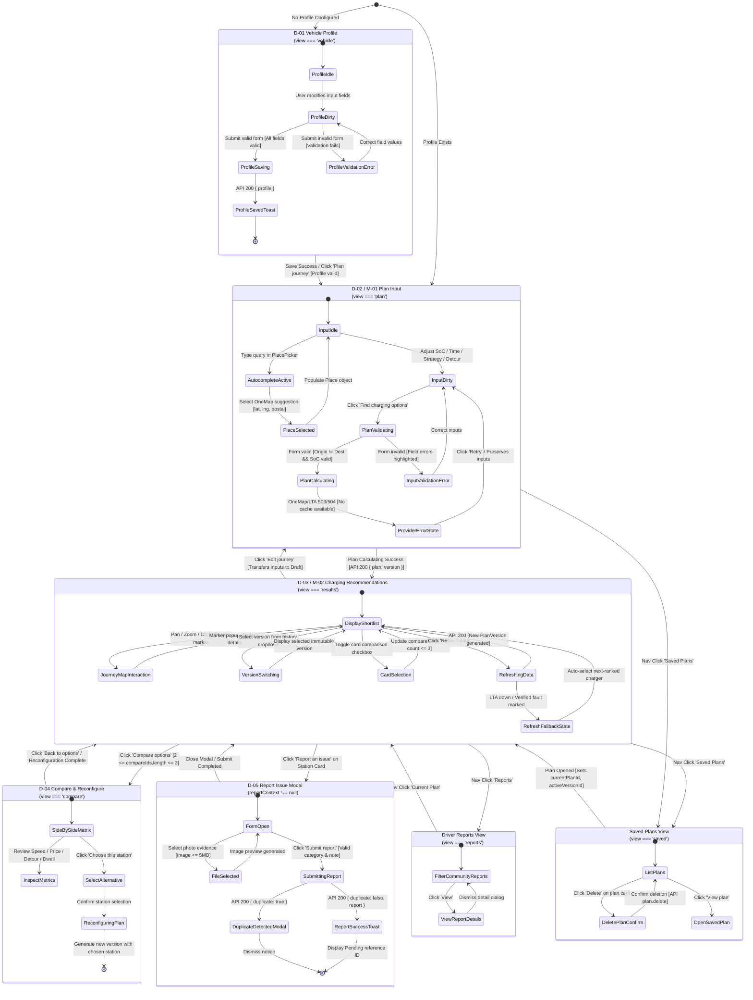
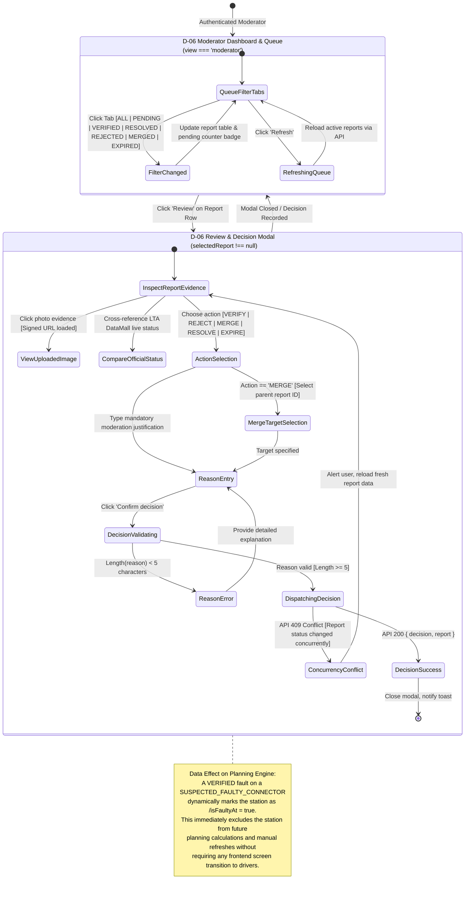
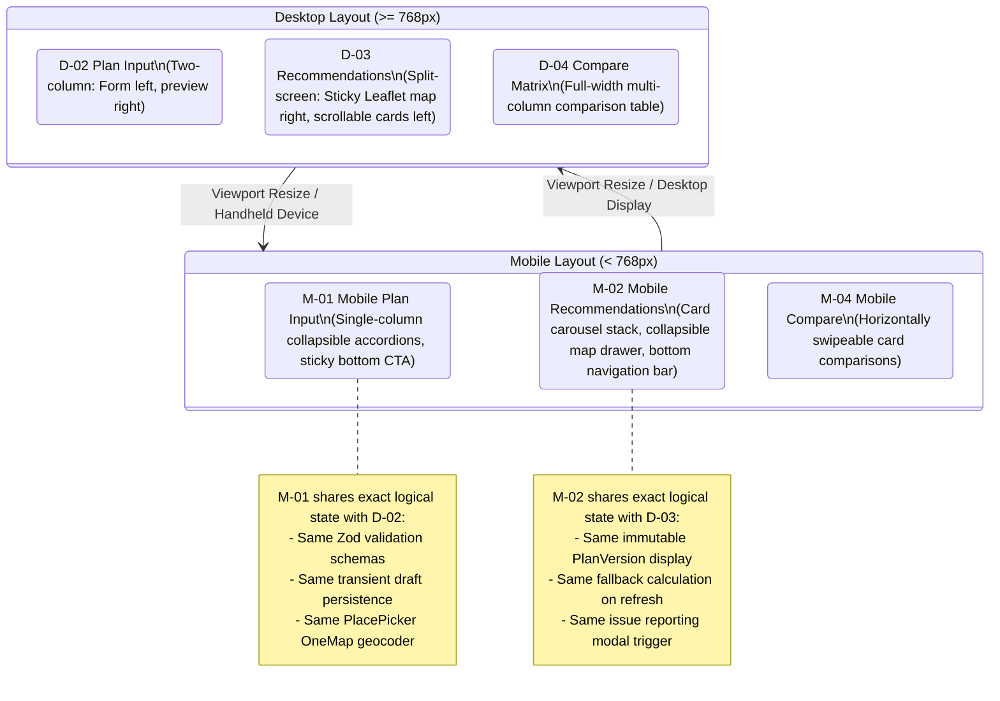

# PlugPlan SG — Refined Dialog Map (Design Model)

**Module:** SC2006 Software Engineering  
**Deliverable:** Lab 3 — Design Model: Dialog Map  
**Team:** SCE3-04  
**Date:** October 2026  
**Compiled Document:** [dialogMap.pdf](dialogMap.pdf) *(Complete 9-page visual deliverable with landscape diagram sheets)*  
**Reference Standards:** Christopher Fox (2006), *Introduction to Software Engineering Design*, Chapter 13.3 "Dialog Maps", p. 420; Bernd Bruegge & Allen H. Dutoit, *Object-Oriented Software Engineering*, Chapter 7.4.

---

## 1. Executive Summary & Evolution from Lab 2

In **Lab 2 (Requirements Analysis)**, an initial Dialog Map was established as an analysis-level UI State Machine. It defined the logical boundary interactions between the system's primary actors (EV Driver and Moderator) and high-level abstract frames (`S0` through `S6` corresponding to `D-00` through `D-06` and responsive variants `M-01`/`M-02`).

In **Lab 3 (Design and Implementation)**, this Dialog Map is formally refined from an **Analysis Model** into a concrete **Design Model** aligned with:
1. **The Layered Client-Server Architecture** (`systemArchitecture.md`): Five distinct architectural tiers separating Presentation, Application/Control, Domain, Integration, and Persistence.
2. **The Design Class Model** (`classDiagram.md`): Boundary/presentation components (`PlugPlanApp`, `AuthScreen`, `JourneyMap`, `PlacePicker`, `Modal`), client API controllers (`ApiClient`, `RouteHandler`, `ServiceHandler`), and persistent/domain entities (`SavedPlan`, `PlanVersion`, `IssueReport`, `ModerationDecision`).
3. **The Implementation Prototype & Skeleton** (`PlugPlan SG/src/components/plugplan-app.tsx`): Concrete client view states (`plan`, `vehicle`, `saved`, `results`, `compare`, `reports`, `moderator`), modal overlays (`reportContext`, `duplicateReport`, `selectedReport`), and asynchronous state transitions.
4. **Christopher Fox's Design Heuristics (Fox p. 420)**: Rigorous state-event-guard-action specifications, modal dialog overlays, transient input drafts vs. persistent database entities, and annotated UI callouts detailing constraints, enabled/disabled triggers, and data state badges (`LIVE`, `CACHED`, `STALE`, `DEMO_FIXTURE`).

### Key Refinements from Lab 2 to Lab 3

| Aspect | Lab 2 Analysis Model (Initial) | Lab 3 Design Model (Refined) | Design Justification |
|---|---|---|---|
| **State Granularity** | 7 high-level logical states (`S0`–`S6`) with informal sub-variants. | 14 discrete design states encompassing 7 primary screen views, 4 modal overlays, and 3 transient/busy states. | Explicitly models modal lifecycles, dirty-state confirmation, and asynchronous gateway waits. |
| **Transition Formalism** | High-level trigger descriptions (e.g., "Valid journey and provider results"). | Precise UML event-guard-action syntax: `Event [Guard] / Action -> Next State`. | Eliminates ambiguity for frontend implementation and test automation (Playwright/Jest). |
| **Component Mapping** | Abstract boundary references (`D-00`–`D-06`). | Concrete React component bindings (`PlugPlanApp`, `AuthScreen`, `JourneyMap`, `PlacePicker`, `Modal`). | Direct 1:1 mapping between design artifacts and TypeScript/React implementation. |
| **Modal & Overlay Semantics** | Modals treated as generic self-loops or textual notes. | Formal modal overlay states (`ReportIssueModal`, `DuplicateAlertModal`, `ReportReviewModal`) with distinct entry, validation, and dismissal paths. | Adheres to Fox p. 420 dialog acceptor principles; preserves background view state while modal is active. |
| **State Persistence vs. Transient Drafts** | Abstract note regarding transient drafts. | Clear architectural partition: in-memory React state (`Draft`, `dirty` flag) vs. persistent PostgreSQL entities via `ApiClient.api()`. | Protects users from accidental navigation loss via dirty checks; respects stateless server architecture. |
| **Concurrency & Error Handling** | Generic exception bullet points. | Explicit handling for HTTP 409 conflict (concurrent moderation), HTTP 429 rate limit, OneMap/LTA provider timeouts, and fallback cached snapshots. | Solves real-world distributed system edge cases in accordance with Bruegge Chapter 7.4. |
| **Responsive Mapping** | Textual equivalence (`M-01 = D-02`, `M-02 = D-03`). | Explicit responsive UI adaptation states and interaction flows (mobile accordion drawers, bottom navigation bar, touch cards). | Ensures complete WCAG 2.1 accessibility and mobile parity across viewports. |

---

## 2. Global System Dialog Map (Role-Based Routing)

The global system dialog map governs authentication, session lifecycle, and strict role-based workspace partitioning between EV Drivers and System Moderators.




---

## 3. Driver Journey Dialog Map (Detailed State Machine)

The Driver journey encompasses vehicle profile configuration (UC-02), charging plan creation (UC-03), recommendation analysis (UC-03/06), multi-charger comparison (UC-04), plan reconfiguration (UC-05), manual refresh and fallback recovery (UC-06), and community issue reporting (UC-07).




---

## 4. Moderator Journey & Reporting Dialog Map (Detailed State Machine)

The Moderator journey governs community issue report auditing, official status cross-referencing, multi-action adjudication (Verify, Reject, Merge, Resolve, Expire), mandatory justification validation, and optimistic concurrency conflict handling (UC-08).




---

## 5. Responsive and Mobile UI Dialog Adaptations (M-01 & M-02)

To comply with Lab 1 requirements and Lab 2 analysis models, PlugPlan SG provides responsive adaptations for handheld viewports (e.g., iPhone / Android smartphones, width < 768px):




---

## 6. Comprehensive State Transition Specification Matrix

The following table formally specifies every state transition in PlugPlan SG. Each entry defines the precise trigger event, guard conditions, system actions (including API invocations and component state updates), target state, design class bindings, and traceability to Use Cases and Functional Requirements.

| ID | Current State (From) | Trigger Event | Guard Condition | Action / Side Effect | Next State (To) | Design Classes Involved | Traceability |
|---|---|---|---|---|---|---|---|
| **T-01** | `D-00 AuthScreen` | Click "Sign In" | Form fields non-empty; valid email format | `ApiClient.api('auth.signin')`; set JWT token and session | `D-01` or `D-02` (Driver) / `D-06` (Moderator) | `AuthScreen`, `ApiClient`, `RouteHandler`, `AuthGuard` | UC-01, FR-01 |
| **T-02** | `D-00 AuthScreen` | Click "Create Account" | Valid email, password length >= 6 | `ApiClient.api('auth.signup')`; create profile stub | `D-01 Vehicle Profile` | `AuthScreen`, `ApiClient`, `RouteHandler`, `AuthGuard` | UC-01, FR-02 |
| **T-03** | `D-00 AuthScreen` | Submit invalid credentials | Auth failure (HTTP 400 / 401) | Display inline error banner: "Invalid email or password" | `D-00 AuthScreen` (SignInError) | `AuthScreen`, `ErrorMapper` | UC-01 (Exceptions) |
| **T-04** | Any Authenticated State | Click "Sign out" | User confirmed | Invalidate Supabase session; clear local state and JWT | `D-00 AuthScreen` | `PlugPlanApp`, `SupabaseClient` | UC-01 |
| **T-05** | Any Authenticated State | API returns HTTP 401 | JWT expired or revoked | Clear session; display toast "Session expired, please sign in" | `D-00 AuthScreen` | `ApiClient`, `AuthGuard`, `PlugPlanApp` | UC-01 |
| **T-06** | `D-01 Vehicle Profile` | Modify input field | Field value changed | Set `dirty = true`; update `profileDraft` | `D-01 ProfileDirty` | `PlugPlanApp` | UC-02 |
| **T-07** | `D-01 Vehicle Profile` | Click "Save vehicle" | `profileSchema.safeParse` passes | `ApiClient.api('profile.save')`; update `data.profile`; set `dirty = false`; toast confirmation | `D-02 Plan Input` | `PlugPlanApp`, `ApiClient`, `PlanRepository`, `ValidationSchemas` | UC-02, FR-03, FR-04 |
| **T-08** | `D-01 Vehicle Profile` | Click "Save vehicle" | `profileSchema.safeParse` fails | Highlight invalid fields (e.g. capacity < 10 or > 250); block submission | `D-01 ProfileValidationError` | `PlugPlanApp`, `ValidationSchemas` | UC-02 (Exceptions) |
| **T-09** | `D-01 Vehicle Profile` | Click "Delete profile" | User confirms alert | `ApiClient.api('profile.delete')`; reset `profileDraft` to default | `D-01 ProfileIdle` (Empty) | `PlugPlanApp`, `PlanRepository` | UC-02 |
| **T-10** | `D-02 Plan Input` | Type in search input | Query string >= 2 chars | Debounced OneMap search via `ProviderGateway.searchPlaces()` | `D-02 AutocompleteActive` | `PlacePicker`, `ProviderGateway` | UC-03, FR-05 |
| **T-11** | `D-02 Plan Input` | Select place suggestion | Suggestion clicked | Set `origin` or `destination` place object; close dropdown | `D-02 PlaceSelected` | `PlacePicker`, `PlugPlanApp` | UC-03, FR-05 |
| **T-12** | `D-02 Plan Input` | Click "Find charging options" | `planInputSchema` passes; Origin != Dest | Set `busy = true`; `ApiClient.api('plan.create')`; generate plan and v1 | `D-03 Recommendations` | `PlugPlanApp`, `ApiClient`, `PlanEngine`, `ProviderGateway`, `PlanRepository` | UC-03, FR-05–19 |
| **T-13** | `D-02 Plan Input` | Click "Find charging options" | Form invalid (e.g. Origin missing, SoC <= 0) | Display field validation errors; focus first invalid field | `D-02 InputValidationError` | `PlugPlanApp`, `ValidationSchemas` | UC-03 (Exceptions) |
| **T-14** | `D-02 Plan Input` | Click "Find charging options" | OneMap/LTA timeout; no cached data | Catch ApiError (503/504); display error banner; retain all input values | `D-02 ProviderErrorState` | `PlugPlanApp`, `ProviderGateway`, `ErrorMapper` | UC-03 (Exceptions) |
| **T-15** | `D-02 Plan Input` | Nav click with dirty form | `dirty === true` | Display `UnsavedChangesPromptModal` ("Discard inputs?") | `UnsavedChangesModal` | `PlugPlanApp` | UC-03 |
| **T-16** | `D-03 Recommendations` | Click "Edit journey" | Plan version loaded | Set `draft = version.inputs`; set `editPlanId = plan.id`; navigate | `D-02 Plan Input` | `PlugPlanApp` | UC-05 |
| **T-17** | `D-03 Recommendations` | Toggle charger checkbox | Card clicked | If selected: remove; if unselected and count < 3: add to `compareIds` | `D-03 CardSelection` | `PlugPlanApp` | UC-04, FR-20 |
| **T-18** | `D-03 Recommendations` | Click "Compare options" | `compareIds.length` is 2 or 3 | Filter recommendations by `compareIds`; switch view | `D-04 Compare & Reconfigure` | `PlugPlanApp` | UC-04, FR-20 |
| **T-19** | `D-03 Recommendations` | Change version dropdown | Version ID selected | Set `activeVersionId = id`; re-render `JourneyMap` and cards | `D-03 DisplayShortlist` | `PlugPlanApp`, `JourneyMap` | UC-05, FR-21 |
| **T-20** | `D-03 Recommendations` | Click "Refresh data" | Network active | Set `busy = true`; `ApiClient.api('plan.refresh')`; re-fetch LTA snapshot; re-calculate | `D-03 Recommendations` (New Version) | `PlugPlanApp`, `PlanEngine`, `ProviderGateway`, `PlanRepository` | UC-06, FR-22, FR-23 |
| **T-21** | `D-03 Recommendations` | Refresh with station marked faulty | Station in v(N) verified faulty in v(N+1) | PlanEngine fault-filter excludes station; auto-selects next best eligible candidate | `D-03 RefreshFallbackState` | `PlanEngine`, `ModeratorFaultFilter` | UC-06, FR-24 |
| **T-22** | `D-03 Recommendations` | Click "Report an issue" | Charger card clicked | Set `reportContext = { station, connector }`; open modal | `D-05 Report Issue Modal` | `PlugPlanApp`, `Modal` | UC-07 |
| **T-23** | `D-04 Compare & Reconfigure`| Click "Back to options" | Comparison active | Switch `view = 'results'`; preserve active version | `D-03 Recommendations` | `PlugPlanApp` | UC-04 |
| **T-24** | `D-04 Compare & Reconfigure`| Click "Choose this station" | Candidate selected | Set recommendation as primary; generate new immutable PlanVersion | `D-03 Recommendations` (New Version) | `PlugPlanApp`, `PlanRepository` | UC-05, FR-21 |
| **T-25** | `D-05 Report Issue Modal` | Select photo file | File size <= 5 MB; MIME type image/* | Read file; generate object preview URL; store File in component state | `D-05 FileSelected` | `PlugPlanApp`, `SupabaseClient` | UC-07 |
| **T-26** | `D-05 Report Issue Modal` | Click "Submit report" | Valid category; note non-empty; no duplicate | Upload photo to private bucket; `ApiClient.api('report.submit')`; set status PENDING | `D-05 ReportSuccessToast` | `PlugPlanApp`, `ReportRepository`, `SupabaseClient` | UC-07, FR-24 |
| **T-27** | `D-05 Report Issue Modal` | Click "Submit report" | Active report exists for same station/category | API returns `{ duplicate: true, report }`; open duplicate notice | `D-05 DuplicateDetectedModal`| `PlugPlanApp`, `Modal` | UC-07 (Exceptions) |
| **T-28** | `D-05 Report Issue Modal` | Click "Cancel" / Backdrop | No pending upload | Reset `reportContext = null`; close modal without saving | `D-03 Recommendations` | `PlugPlanApp` | UC-07 |
| **T-29** | `D-06 Moderator Dashboard` | Click status filter pill | Pill clicked (e.g. 'PENDING') | Filter local reports array by `statusLabel(r) === filter` | `D-06 QueueFilterTabs` | `PlugPlanApp` | UC-08 |
| **T-30** | `D-06 Moderator Dashboard` | Click "Review" on report row | Moderator authorized | Set `selectedReport = r`; set `moderationAction = 'VERIFY'`; clear errors; open modal | `D-06 Review Modal` | `PlugPlanApp`, `Modal` | UC-08 |
| **T-31** | `D-06 Review Modal` | Click "Confirm decision" | `reason.trim().length >= 5`; Action valid | `ApiClient.api('report.moderate', { reportId, action, reason })`; append ModerationDecision | `D-06 Review Modal` (DecisionSuccess) | `PlugPlanApp`, `ReportRepository`, `ModerationControl` | UC-08, FR-25 |
| **T-32** | `D-06 Review Modal` | Click "Confirm decision" | `reason.trim().length < 5` | Display inline validation error: "Justification reason is required (min 5 chars)" | `D-06 ReasonError` | `PlugPlanApp` | UC-08 (Exceptions) |
| **T-33** | `D-06 Review Modal` | Click "Confirm decision" | Report status modified by other moderator | Catch HTTP 409 Conflict; display alert: "Report updated concurrently. Refreshing..."; reload | `D-06 ConcurrencyConflict` | `PlugPlanApp`, `ErrorMapper`, `ReportRepository` | UC-08 (Exceptions) |
| **T-34** | `Saved Plans View` | Click "Open plan" | Plan row clicked | Set `currentPlanId = plan.id`; set `activeVersionId = latestVersion`; view = 'results' | `D-03 Recommendations` | `PlugPlanApp`, `JourneyMap` | UC-03, UC-04 |
| **T-35** | `Saved Plans View` | Click "Delete plan" | Plan deletion confirmed | `ApiClient.api('plan.delete')`; remove from `data.plans`; toast alert | `Saved Plans View` | `PlugPlanApp`, `PlanRepository` | UC-03 |

---

## 7. UI View Specifications & Fox Callouts (Fox p. 420)

As prescribed by Christopher Fox (*Introduction to Software Engineering Design*, p. 420), a dialog map is supplemented by UI state callout specifications that define visual elements, component hierarchies, constraints, enabled/disabled states, data freshness badges, and dynamic visibility rules.

```
+----------------------------------------------------------------------------------------------------+
| PlugPlan SG Application Shell (PlugPlanApp)                                                        |
+----------------------------------------------------------------------------------------------------+
| [Callout C-01: Global Workspace Sidebar & Access Navigation]                                       |
| - Navigation Items:                                                                                |
|   * Plan a Charge (D-02 / M-01) [Always visible for Driver; active for results/compare]             |
|   * Vehicle Profile (D-01) [Driver only; displays warning dot if profile is incomplete]            |
|   * Saved Plans (SavedPlansView) [Driver only; displays count badge of active plans]               |
|   * Community Reports (DriverReportsView) [Driver only; read-only list of verified/pending issues] |
|   * Moderation Queue (D-06) [MODERATOR only; displays live badge count of PENDING reports]        |
| - User Session & Role Chip:                                                                        |
|   * Displays user email and role badge ('DRIVER' | 'MODERATOR')                                    |
|   * Sign Out button (Triggers T-04, revokes Supabase session token)                                |
+----------------------------------------------------------------------------------------------------+
```

### Callout C-02: D-00 Account Access (`AuthScreen`)
- **Mode Toggle:** Switcher between "Sign in" and "Create account" without full page reload.
- **Form Controls:** Email input (HTML5 `type="email"`, required), password input (`type="password"`, `minlength="6"`, required).
- **Disabled State:** "Sign In" / "Create Account" button is disabled while an authentication request is in flight (`busy === true`).
- **Error Presentation:** Role-agnostic error banner (prevents username enumeration) for invalid credentials; specific password-strength indicators on registration.

### Callout C-03: D-01 Vehicle Profile View (`VehicleProfileView`)
- **Battery Capacity Input:** Numeric input constrained to `10.0`–`250.0` kWh (step `0.1`).
- **Consumption Input:** Numeric input constrained to `5.0`–`50.0` kWh / 100 km.
- **Reserve SoC Input:** Slider and numeric input constrained to `5%`–`40%` (default `15%`).
- **Max Detour Input:** Constrained to `0`–`45` minutes (default `15` min).
- **Charging Limit Inputs:** AC charging rate (`3.0`–`43.0` kW) and DC charging rate (`0.0`–`350.0` kW).
- **Plug Type Multi-Select:** Toggle buttons for `Type 2 (AC)`, `CCS2 (DC)`, `CHAdeMO (DC)`. At least one plug type must be selected.
- **Dirty State Protection:** If user navigates away with uncommitted changes, an unsaved changes confirmation modal is presented.

### Callout C-04: D-02 / M-01 Plan Input View (`PlanInputView`)
- **Origin & Destination Inputs:** Powered by `PlacePicker`. Debounced OneMap API search queries. Clicking a suggestion commits latitude, longitude, and postal code.
- **Target Battery SoC:** Toggle between "Smart Arrival Reserve" (automatic calculation based on destination distance + reserve SoC) and "Manual Target %" (`20%`–`100%`).
- **Strategy Selector:** Five radio/segmented cards:
  1. `Balanced` (Default: optimal trade-off of speed, cost, and detour)
  2. `Fastest` (Prioritizes high-power DC chargers and minimal dwell time)
  3. `Cheapest` (Prioritizes lowest $/kWh tariff)
  4. `Max Availability` (Prioritizes multi-bay stations with multiple unoccupied plugs)
  5. `Min Detour` (Prioritizes closest proximity to direct journey route)
- **Disabled State:** "Find charging options" button is disabled until both origin and destination have valid coordinates and vehicle profile is loaded.

### Callout C-05: D-03 / M-02 Charging Recommendations View (`ResultsView`)
- **Data State Badge:** Prominently displays official provider state:
  * `LIVE` (Green): Live LTA DataMall availability retrieved within the last 5 minutes.
  * `CACHED` (Blue): Provider data retrieved within cache TTL (10 minutes).
  * `STALE` (Amber): Provider API unreachable; using cached snapshot with explicit warning.
  * `DEMO_FIXTURE` (Purple): Operating in offline demonstration mode.
- **Version Selector:** Dropdown listing all immutable versions for this plan (`Version 1`, `Version 2 - refreshed`, etc.). Selecting a previous version re-renders map and metrics without making new external API calls.
- **Interactive Leaflet Map (`JourneyMap`):**
  * Origin pin (Green marker with start icon).
  * Destination pin (Red marker with checkered flag icon).
  * Route polyline (Decoded from OneMap router geometry).
  * Recommendation pins (Blue numbered markers for Option 1, 2, 3; clicking marker scrolls to card).
- **Recommendation Cards:**
  * Displays Rank, Station Name, Address, Connector Power (kW), Availability Status (`AVAILABLE` / `OCCUPIED`), Detour Distance & Time, Charging Dwell Time, Energy Delivered (kWh), and Estimated Cost ($ SGD).
  * Comparison Checkbox: Allows selecting up to 3 cards.
  * "Report an issue" link: Opens D-05 modal with pre-filled station and connector context.
- **Compare Button:** Enabled if and only if `2 <= compareIds.length <= 3`.

### Callout C-06: D-04 Compare & Reconfigure View (`CompareView`)
- **Side-by-Side Matrix Table:** Column-based comparison comparing 2 or 3 selected recommendations across identical metrics:
  * Power (kW) & Plug Type
  * Bay Availability (e.g., "2 of 4 bays free")
  * Dwell Duration to reach target SoC
  * Detour Penalty (km and minutes off optimal route)
  * Estimated Charging Cost (SGD)
  * Walking Distance to nearest amenities (meters)
- **Action Triggers:**
  * "Choose this station": Reconfigures plan around chosen charger, creating a new immutable `PlanVersion`.
  * "Back to options": Returns to D-03 without creating a new version.

### Callout C-07: D-05 Report Issue Modal (`ReportIssueModal`)
- **Pre-filled Context:** Station name, address, and connector ID automatically populated from parent recommendation card.
- **Category Selector:** Dropdown offering `BLOCKED_BAY`, `SUSPECTED_FAULTY_CONNECTOR`, `INCORRECT_LOCATION`, `ACCESS_PROBLEM`.
- **Note Field:** Free-text textarea for description (max 500 characters).
- **Photo Upload Field:** File input with image preview; supports JPEG/PNG up to 5 MB. Files are uploaded directly to Supabase Storage private bucket `issue-images`.
- **Duplicate Notice Modal:** If another driver reported the same issue within 24 hours, the submission is rejected with a polite notice acknowledging community vigilance without creating duplicate database clutter.

### Callout C-08: D-06 Moderator Dashboard & Decision Modal (`ModeratorReviewView`)
- **Queue Filter Tabs:** Segmented filter buttons with dynamic pending counter: `All`, `Pending (N)`, `Verified`, `Resolved`, `Rejected`, `Merged`, `Expired`.
- **Photo Evidence Viewer:** Displays high-resolution uploaded driver photo via secure time-limited Supabase Storage signed URLs.
- **Official LTA Status Display:** Displays real-time status recorded by LTA DataMall alongside community report to detect divergence.
- **Decision Controls:**
  * Five explicit action buttons: `VERIFY`, `REJECT`, `MERGE`, `RESOLVE`, `EXPIRE`.
  * If `MERGE` is selected, an autocomplete dropdown appears to select parent report ID.
  * Justification Textarea: Required; minimum 5 characters. "Confirm decision" button is disabled if textarea is empty or whitespace only.
- **Concurrency Conflict Notice:** If HTTP 409 is returned from backend, an error modal informs the moderator that another team member already adjudicated the report, and the view reloads the updated record.

---

## 8. Key Design Issues Resolution (Bruegge Chapter 7.4)

### 8.1 Access Control and Security
- **Authentication:** Managed via Supabase Auth with secure HTTP-only cookies and JSON Web Tokens (JWT).
- **Role Verification:** Implemented in `AuthGuard` (`src/lib/server/supabase.ts`). Every incoming request to `/api/app` is checked:
  * `requireDriver(context)` verifies `user.role === 'DRIVER'`.
  * `requireModerator(context)` verifies `user.role === 'MODERATOR'`.
- **Database Row-Level Security (RLS):** All Postgres tables (`ev_profiles`, `saved_plans`, `plan_versions`, `issue_reports`, `moderation_decisions`) enforce RLS policies matching the authenticated JWT `auth.uid()`. Even if client-side view state were tampered with, database-level operations fail automatically.

### 8.2 Persistent vs. Transient State Management
- **Persistent Data:**
  * Vehicle profiles, saved journey plans, immutable plan versions, and community issue reports are stored persistently in Supabase Postgres.
- **Transient Data:**
  * Draft plan inputs (`origin`, `destination`, `currentSoc`, `manualTargetSoc`) exist in React component state (`draft`) while the driver is configuring a journey.
  * If a driver triggers an external search that fails, or inputs an ambiguous place, transient draft inputs are preserved in memory to prevent input loss.
  * Abandoning the session or navigating away resets the transient draft unless saved.

### 8.3 Concurrency Control (Optimistic Locking & HTTP 409)
- When a Moderator submits a decision in `D-06`, the database RPC `moderate_report` verifies the current `status` and `updated_at` timestamp.
- If two moderators review the same pending report simultaneously:
  1. The first moderator's decision succeeds (e.g., changes status from `PENDING` to `VERIFIED`).
  2. The second moderator's submission detects a status change conflict, rejects the update, and returns HTTP 409 `ConflictError`.
  3. The client dialog map intercepts the 409 error, leaves `D-06` open, displays a toast alert ("Report was updated by another moderator"), and re-fetches the latest report state.

### 8.4 Degraded Mode & Provider Resilience
- If OneMap Routing API or LTA DataMall EV Charging Points API experiences latency or outage:
  1. `ProviderGateway` enforces a strict 3.9-second deadline budget.
  2. If live fetch fails, it checks the local cache (`.cache/lta-public.json`).
  3. If cached data exists, it marks the snapshot as `STALE`, allows plan calculation to continue, and displays an amber warning badge in `D-03`.
  4. If no cached data exists, it returns a 503 error, and the dialog map remains in `D-02`, retaining all user inputs and displaying a "Providers currently unavailable — please retry" notice.

---

## 9. Comprehensive Requirements & Class Traceability Matrix

| Use Case | UI Frame(s) | UI States | Design Classes Involved | Architectural Layer | Functional Requirements |
|---|---|---|---|---|---|
| **UC-01 Access Account** | `D-00` | `SignInMode`, `SignUpMode`, `SignInError` | `AuthScreen`, `ApiClient`, `RouteHandler`, `AuthGuard`, `SupabaseClient` | Presentation, Application, Persistence | FR-01, FR-02 |
| **UC-02 Manage EV Profile** | `D-01` | `ProfileIdle`, `ProfileDirty`, `ProfileSaving`, `ProfileValidationError` | `PlugPlanApp`, `ApiClient`, `PlanRepository`, `ValidationSchemas` | Presentation, Application, Domain, Persistence | FR-03, FR-04 |
| **UC-03 Create Charging Plan** | `D-02`, `D-03`, `M-01`, `M-02` | `InputIdle`, `AutocompleteActive`, `PlanValidating`, `PlanCalculating`, `DisplayShortlist` | `PlugPlanApp`, `PlacePicker`, `JourneyMap`, `ApiClient`, `PlanEngine`, `ProviderGateway`, `PlanRepository` | Presentation, Application, Domain, Integration, Persistence | FR-05, FR-06, FR-07, FR-08, FR-09, FR-10, FR-11, FR-12, FR-13, FR-14, FR-15, FR-16, FR-17, FR-18, FR-19 |
| **UC-04 Review and Compare** | `D-03`, `D-04`, `M-02` | `CardSelection`, `SideBySideMatrix`, `InspectMetrics` | `PlugPlanApp`, `JourneyMap`, `ApiClient` | Presentation | FR-20 |
| **UC-05 Reconfigure Plan** | `D-04`, `D-03` | `SelectAlternative`, `ReconfiguringPlan`, `VersionSwitching` | `PlugPlanApp`, `PlanEngine`, `PlanRepository` | Presentation, Domain, Persistence | FR-21 |
| **UC-06 Refresh and Fallback** | `D-03`, `M-02` | `RefreshingData`, `RefreshFallbackState` | `PlugPlanApp`, `PlanEngine`, `ProviderGateway`, `ModeratorFaultFilter`, `PlanRepository` | Presentation, Domain, Integration, Persistence | FR-22, FR-23, FR-24 |
| **UC-07 Submit Charger Issue** | `D-05` | `FormOpen`, `FileSelected`, `SubmittingReport`, `DuplicateDetectedModal` | `PlugPlanApp`, `Modal`, `ApiClient`, `ReportRepository`, `SupabaseClient` | Presentation, Application, Persistence | FR-24 |
| **UC-08 Moderate Charger Reports** | `D-06` | `QueueFilterTabs`, `InspectReportEvidence`, `ActionSelection`, `ReasonEntry`, `ConcurrencyConflict` | `PlugPlanApp`, `Modal`, `ApiClient`, `ReportRepository`, `ModerationControl`, `ModerationDecision` | Presentation, Application, Domain, Persistence | FR-25 |

---

## 10. Conclusion

The refined Dialog Map for Lab 3 bridges the conceptual requirements analysis of Lab 2 with the concrete object-oriented design and implementation architecture of Lab 3. By incorporating:
- Formal state-event-guard-action transition semantics,
- Complete modal overlay lifecycles,
- Explicit distinction between persistent database entities and transient React input drafts,
- Rigorous handling of network degradation and optimistic concurrency conflicts (HTTP 409), and
- Christopher Fox's UI state callouts,

the dialog map serves as an authoritative specification for both frontend presentation behavior (`PlugPlanApp`, `AuthScreen`, `JourneyMap`, `PlacePicker`) and backend API coordination (`RouteHandler`, `ServiceHandler`, `PlanEngine`, `PlanRepository`, `ReportRepository`).
