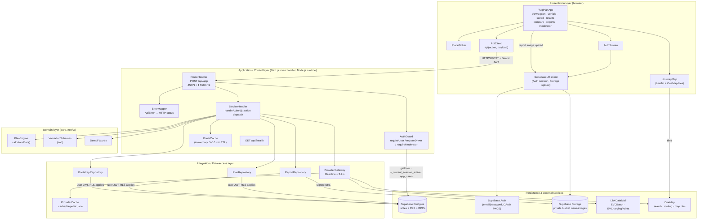
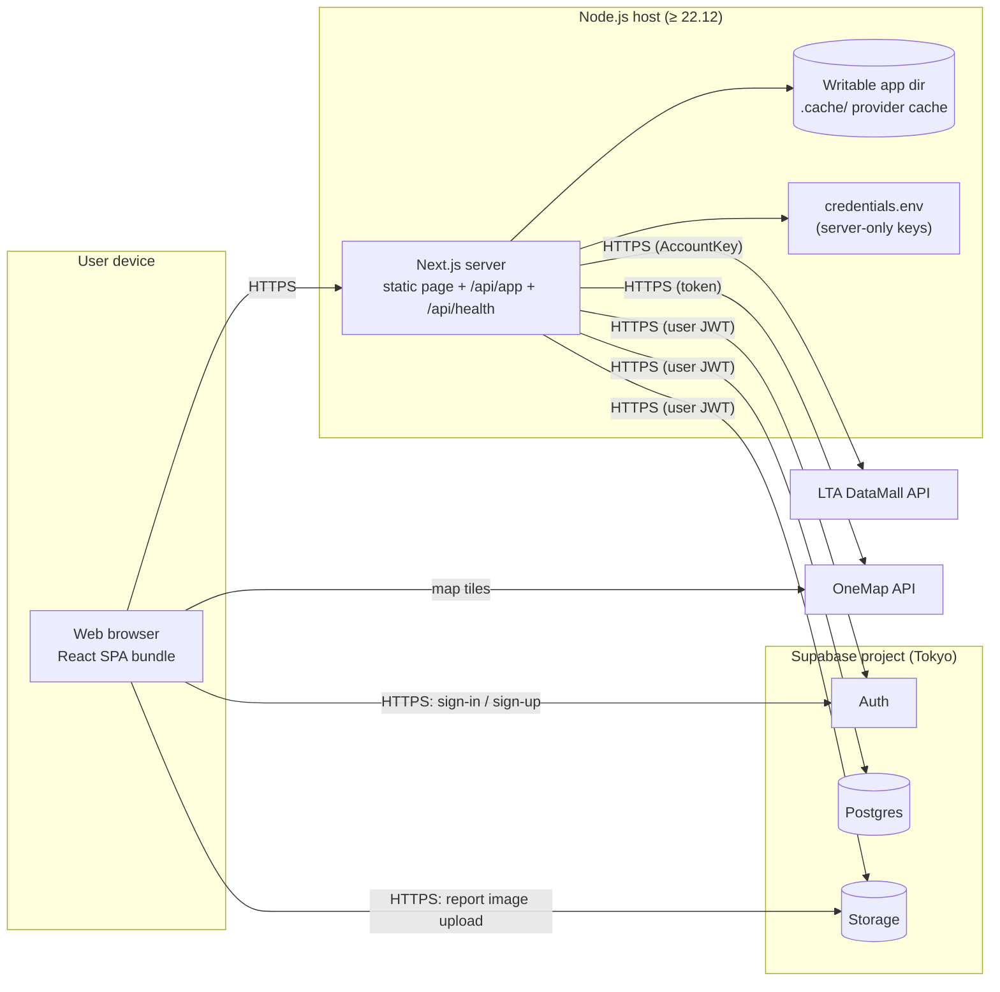
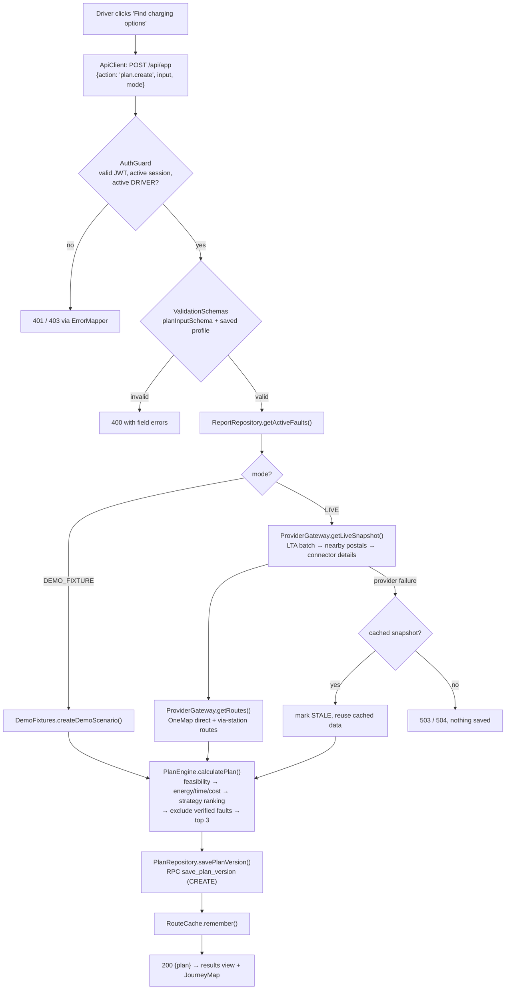

# PlugPlan SG — System Architecture

## 1. Architectural style

PlugPlan SG uses a **layered client–server architecture** with five layers. Each layer calls only the layer below it.

| Layer | Responsibility | Code |
|---|---|---|
| **Presentation** | Browser UI: views, forms, map, client-side state | `src/components/plugplan-app.tsx`, `journey-map.tsx`, `src/app/page.tsx` |
| **Application / Control** | Single API entry point, authentication, role gates, input validation, use-case coordination | `src/app/api/app/route.ts`, `src/lib/server/service.ts`, `supabase.ts`, `errors.ts` |
| **Domain** | Pure charging-plan calculation (feasibility, energy, cost, ranking), shared schemas, demo fixtures | `src/lib/domain/engine.ts`, `validation.ts`, `fixtures.ts`, `src/lib/types.ts` |
| **Integration / Data access** | Repositories over Supabase tables and RPCs; gateway to external government APIs with timeout and cache | `src/lib/server/db.ts`, `src/lib/server/providers.ts` |
| **Persistence / External services** | Postgres with RLS and stored procedures, Auth, private Storage; LTA DataMall; OneMap | `supabase/migrations/*.sql`; third-party HTTPS APIs |

## 2. Layered architecture diagram

## 3. Deployment view

- LTA and OneMap credentials exist only on the server. The browser receives only the Supabase URL and the public (publishable) key.
- The server never holds a Supabase service-role key. Every database call carries the end user's JWT, so database policies always apply.
- The current delivery is a local demonstration on `127.0.0.1:3000`. A production deployment needs HTTPS at the host or reverse proxy.

## 4. Request flow: create a charging plan (UC-03)

