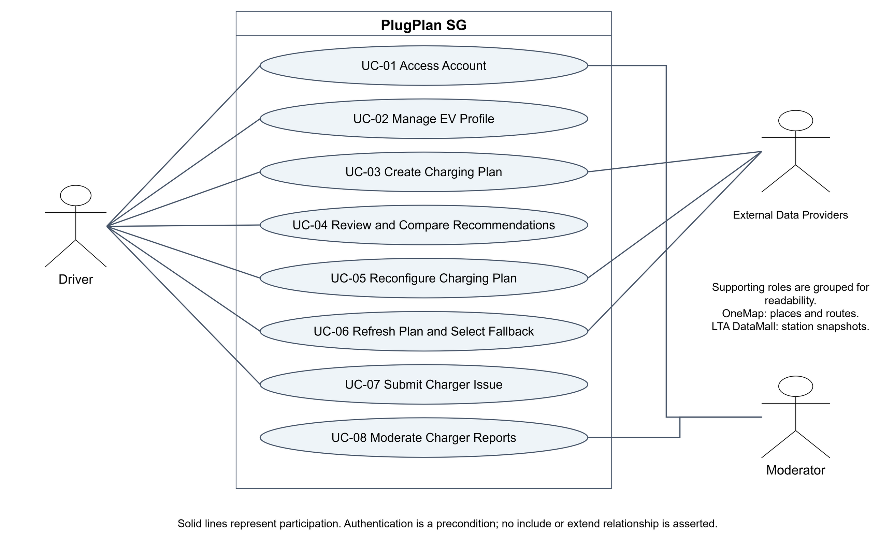

# PlugPlan SG - Final Use Case Model

**Module:** SC2006 Software Engineering  
**Team:** SCE3-04  
**Deliverable:** Lab 3 - Use Case Model  
**Last updated:** 24 October 2026

## 1. Complete use case diagram

### Diagram conventions

- The system boundary contains behaviour owned by PlugPlan SG.
- Solid actor associations indicate participation, not execution order.
- OneMap and LTA DataMall are grouped as **External Data Providers** in the diagram for readability. OneMap supplies place and route data; LTA DataMall supplies station and connector snapshots.
- No `<<include>>` or `<<extend>>` relationship is asserted. Authentication is a precondition for UC-02 to UC-08, not a sub-use-case re-executed within each use case.
- Supabase is an internal implementation component for authentication and persistence, so it is not shown as an external domain actor.

## 2. Use case catalogue

| ID | Use case | Primary actor | Supporting actor |
|---|---|---|---|
| UC-01 | Access Account | Driver or Moderator | - |
| UC-02 | Manage EV Profile | Driver | - |
| UC-03 | Create Charging Plan | Driver | OneMap and LTA DataMall |
| UC-04 | Review and Compare Recommendations | Driver | - |
| UC-05 | Reconfigure Charging Plan | Driver | OneMap and LTA DataMall, when fresh data is required |
| UC-06 | Refresh Plan and Select Fallback | Driver | OneMap and LTA DataMall |
| UC-07 | Submit Charger Issue | Driver | - |
| UC-08 | Moderate Charger Reports | Moderator | - |

## UC-01 - Access Account

| Field | Value |
|---|---|
| Created by | Team SCE3-04 |
| Last updated by | Team SCE3-04 |
| Date created | 4 September 2026 |
| Date updated | 24 October 2026 |
| Actor(s) | Driver or Moderator |
| Priority | High |
| Frequency | At the start of each authenticated session |
| Traceability | FR-01, FR-02; D-00 |

**Description.** A new Driver registers, or an existing Driver or Moderator signs in and reaches the workspace allowed by the account role.

**Preconditions**

- The user can access the PlugPlan SG web application.
- For sign-in, an active account exists.

**Postconditions**

- An authenticated session is established and the application has loaded the user's persisted role.
- The user is shown the Driver or Moderator workspace; after logout, the session is invalidated.

**Normal flow of events**

1. The user selects the sign-in function.
2. The system displays the email and password form.
3. The user enters credentials and submits the form.
4. The system validates the credentials and loads the user's role.
5. The system establishes the session and displays the role-appropriate workspace.

**Alternative flows**

- UC-01.A1 - At step 1, a new user selects registration, supplies a unique email and compliant password, and the system creates a Driver account before continuing at step 5.
- UC-01.A2 - From an authenticated workspace, the user selects logout; the system invalidates the session and returns to the access screen.

**Exceptions**

- UC-01.E1 - Invalid credentials or an inactive account cause access to be denied with a generic error that does not disclose whether the email exists.
- UC-01.E2 - If the authentication service is unavailable, no session is created and the system displays a retry instruction.

**Includes:** None.

**Special requirements:** NFR-05 and NFR-06 apply. Passwords and session tokens must never be logged or displayed.

**Assumptions:** Moderator accounts are provisioned by the team; public registration creates Driver accounts only. Google and GitHub OAuth are not part of the submitted baseline.

**Notes and issues:** Authentication is modelled as its own user goal. It is a precondition, not an `<<include>>` relationship, for UC-02 to UC-08.

## UC-02 - Manage EV Profile

| Field | Value |
|---|---|
| Created by | Team SCE3-04 |
| Last updated by | Team SCE3-04 |
| Date created | 4 September 2026 |
| Date updated | 24 October 2026 |
| Actor(s) | Driver |
| Priority | High |
| Frequency | Occasionally; before first plan and when vehicle assumptions change |
| Traceability | FR-03, FR-04; D-01 |

**Description.** The Driver creates, updates or deletes the validated EV and planning assumptions used by charging calculations.

**Preconditions**

- The Driver is authenticated.
- The Driver workspace is available.

**Postconditions**

- On save, exactly one validated EV Profile is stored for the Driver.
- On confirmed deletion, the Driver has no active EV Profile; existing saved Plan Versions remain historical records.

**Normal flow of events**

1. The Driver opens EV Profile.
2. The system displays the current profile, or an empty form if none exists.
3. The Driver enters vehicle, battery, connector, charging and route-preference values.
4. The Driver submits the profile.
5. The system validates all required fields and allowed ranges.
6. The system creates or updates the profile and confirms the save.

**Alternative flows**

- UC-02.A1 - At step 3, the Driver cancels; the system discards unsaved edits and restores the last saved values.
- UC-02.A2 - At step 3, the Driver selects Delete; after confirmation, the system removes the profile and displays the empty state.

**Exceptions**

- UC-02.E1 - Missing, inconsistent or out-of-range values are rejected with field-specific messages; the Driver returns to step 3.
- UC-02.E2 - If persistence fails, no partial update is committed and the entered values remain available for retry.

**Includes:** None.

**Special requirements:** Capacity, consumption, plug type, AC/DC power, reserve, detour, minimum charger power and maximum walking distance must be validated server-side.

**Assumptions:** The MVP permits at most one EV Profile per Driver. A valid profile is required before planning.

**Notes and issues:** Changing the profile affects newly created or reconfigured versions; it does not rewrite immutable historical Plan Versions.

## UC-03 - Create Charging Plan

| Field | Value |
|---|---|
| Created by | Team SCE3-04 |
| Last updated by | Team SCE3-04 |
| Date created | 4 September 2026 |
| Date updated | 24 October 2026 |
| Actor(s) | Driver (primary); External Data Providers - OneMap and LTA DataMall (supporting) |
| Priority | Critical |
| Frequency | Once or more per planned journey |
| Traceability | FR-05 to FR-19, FR-24 refinement; D-02, D-03 |

**Description.** The Driver submits journey constraints and receives a saved Plan Version containing up to three feasible, ranked and explained charging recommendations.

**Preconditions**

- The Driver is authenticated and has a valid EV Profile.
- Origin and destination can be selected through OneMap search, or Demo Fixture mode is explicitly selected.

**Postconditions**

- A Charging Plan and immutable Plan Version are stored with inputs, data-state evidence and calculation results.
- Up to three feasible recommendations are displayed, or a clear no-feasible-option result is shown.

**Normal flow of events**

1. The Driver enters origin, destination, state of charge, departure time, charging limit, detour limit, strategy and optional target, then submits.
2. The system validates the inputs and resolves the selected places through OneMap.
3. The system obtains a station snapshot from LTA DataMall and direct/via route results from OneMap.
4. The system computes compatibility, reachability, arrival charge, target energy, charging time, detour, dwell and available cost evidence.
5. The system excludes infeasible or verified-fault options and ranks the remaining connectors using the selected strategy.
6. The system stores the Plan Version and displays up to three recommendations with assumptions, timestamps and data-state labels.

**Alternative flows**

- UC-03.A1 - At step 1, the Driver explicitly selects Demo Fixture mode; the system uses labelled fixture inputs and continues at step 4 without calling live providers.
- UC-03.A2 - At step 2, a place search returns multiple matches; the Driver selects one result and the system continues at step 3.
- UC-03.A3 - At step 4, a manual target is supplied; the system validates and uses it instead of the calculated target.
- UC-03.A4 - At step 5, no charging stop is required or no feasible connector remains; the system stores and explains that result instead of presenting three options.

**Exceptions**

- UC-03.E1 - If no valid route or usable station snapshot is available, the use case fails, no partial Plan Version is stored and the Driver's inputs remain available.
- UC-03.E2 - A provider or calculation error is displayed with its actual LIVE, CACHED, STALE or DEMO_FIXTURE state; the system never silently substitutes demo data.

**Includes:** None.

**Special requirements:** Inputs and computed outputs must be validated server-side. Calculation evidence must be reproducible from the saved snapshot and assumptions.

**Assumptions:** Reserve is 20%, charging efficiency is 90%, and targets above 80% display a taper warning. Price may be unavailable.

**Notes and issues:** OneMap supplies search and route data; LTA DataMall supplies station/connector snapshots. Verified, unexpired suspected-fault reports may remove affected options.

## UC-04 - Review and Compare Recommendations

| Field | Value |
|---|---|
| Created by | Team SCE3-04 |
| Last updated by | Team SCE3-04 |
| Date created | 4 September 2026 |
| Date updated | 24 October 2026 |
| Actor(s) | Driver |
| Priority | High |
| Frequency | After plan creation, reconfiguration or refresh |
| Traceability | FR-18 to FR-20; D-03, D-04 |

**Description.** The Driver inspects recommendation evidence, compares two or three alternatives and records a preferred recommendation without making a reservation.

**Preconditions**

- The Driver is authenticated.
- An owned Plan Version containing at least one recommendation exists.

**Postconditions**

- The selected recommendation, if any, is persisted for the current Plan Version.
- No station reservation, payment or queue position is created.

**Normal flow of events**

1. The Driver opens a Plan Version and requests its recommendations.
2. The system displays ranked cards with route, charging, cost, walking, evidence and data-state details.
3. The Driver selects two or three options for comparison.
4. The system displays the selected options in a consistent metric order.
5. The Driver reviews the trade-offs and selects a preferred recommendation.
6. The system stores the selection and confirms it.

**Alternative flows**

- UC-04.A1 - At step 3, fewer than two recommendations exist; comparison is disabled, but the Driver can continue reviewing the available option.
- UC-04.A2 - At step 4, price data is missing; the system displays Unavailable and does not invent a price.
- UC-04.A3 - At step 1, the Driver opens a saved or historical Plan Version; the system displays that version without modifying newer versions.
- UC-04.A4 - At step 5, the Driver clears or changes the selection; the system stores the new state and confirms it.

**Exceptions**

- UC-04.E1 - If the plan is missing or not owned by the Driver, access is denied and no selection is changed.
- UC-04.E2 - If saving the selection fails, the previous selection remains unchanged and a retry message is shown.

**Includes:** None.

**Special requirements:** All compared options must use the same units and calculation assumptions. A maximum of three options may be compared at once.

**Assumptions:** Recommendations are decision support, not guaranteed charger availability or a booking.

**Notes and issues:** Saved-plan browsing and Plan Version switching are supporting behaviours of review, not additional goal-level use cases.

## UC-05 - Reconfigure Charging Plan

| Field | Value |
|---|---|
| Created by | Team SCE3-04 |
| Last updated by | Team SCE3-04 |
| Date created | 4 September 2026 |
| Date updated | 24 October 2026 |
| Actor(s) | Driver (primary); External Data Providers - OneMap and LTA DataMall (supporting when fresh data is required) |
| Priority | High |
| Frequency | Whenever journey constraints or ranking strategy change |
| Traceability | FR-05, FR-14, FR-18, FR-21, FR-24 refinement; D-03, D-05 |

**Description.** The Driver changes plan inputs or strategy and receives a new immutable Plan Version while retaining the previous version.

**Preconditions**

- The Driver is authenticated and owns the Charging Plan.
- At least one Plan Version already exists.

**Postconditions**

- A new immutable Plan Version is stored and displayed when recalculation succeeds.
- The previous version remains available for comparison and history.

**Normal flow of events**

1. The Driver opens a plan and chooses to edit inputs or change strategy.
2. The system loads the current version's values into the reconfiguration view.
3. The Driver changes one or more values and submits.
4. The system validates the changes and either reuses sufficiently recent evidence or obtains required OneMap/LTA data.
5. The system recalculates feasibility, charging estimates, verified-fault filtering and ranking.
6. The system stores and displays a new Plan Version without overwriting the previous version.

**Alternative flows**

- UC-05.A1 - At step 1, the Driver selects a strategy tab; the system treats this as a strategy-only reconfiguration and continues at step 4.
- UC-05.A2 - At step 3, the Driver cancels; the system discards unsaved edits and returns to the current version.
- UC-05.A3 - At step 5, a formerly recommended connector becomes infeasible; it is omitted from the new ranked result and the explanation identifies the controlling constraint.

**Exceptions**

- UC-05.E1 - If required route or station data cannot be obtained or reused, no partial version is stored and the previous version remains visible.
- UC-05.E2 - If the Driver attempts to leave with unsaved edits, the system requests confirmation before discarding them.

**Includes:** None.

**Special requirements:** Version creation must be atomic. Every version must retain its own inputs, assumptions, evidence timestamps and data-state label.

**Assumptions:** Reconfiguration is user-initiated; continuous background recalculation is outside scope.

**Notes and issues:** Provider participation is conditional because sufficiently recent cached evidence may be reused.

## UC-06 - Refresh Plan and Select Fallback

| Field | Value |
|---|---|
| Created by | Team SCE3-04 |
| Last updated by | Team SCE3-04 |
| Date created | 4 September 2026 |
| Date updated | 24 October 2026 |
| Actor(s) | Driver (primary); External Data Providers - OneMap and LTA DataMall (supporting) |
| Priority | High |
| Frequency | Before departure or when the Driver suspects conditions changed |
| Traceability | FR-07 to FR-19, FR-22 to FR-24; D-03, D-06 |

**Description.** The Driver manually requests newer route and station evidence and selects a fallback if the previously chosen connector is no longer feasible.

**Preconditions**

- The Driver is authenticated and owns a Charging Plan with a current Plan Version.
- The plan has enough stored inputs to be recalculated.

**Postconditions**

- On success, a new Plan Version is stored with refreshed evidence and feasibility results.
- The previous selection is retained if feasible; otherwise it is cleared and the next feasible option is identified for explicit selection.

**Normal flow of events**

1. The Driver selects Refresh on the current Plan Version.
2. The system requests the latest usable OneMap route data and LTA station snapshot.
3. The system recalculates feasibility, estimates, verified-fault filtering and ranking.
4. The system compares the previous selection with the refreshed result.
5. The system stores and displays a new Plan Version, preserving or clearing the old selection as appropriate.
6. The Driver reviews the evidence and explicitly keeps or selects a fallback recommendation.

**Alternative flows**

- UC-06.A1 - At step 2, only cached or stale evidence is usable; the system labels its state and age before continuing at step 3.
- UC-06.A2 - At step 4, the selected connector remains feasible; it remains selected in the new version.
- UC-06.A3 - At step 4, the selected connector is no longer feasible; the system clears it, explains why, and identifies the next ranked option for step 6.
- UC-06.A4 - In Demo Fixture mode, the system refreshes from the labelled fixture snapshot rather than live providers.

**Exceptions**

- UC-06.E1 - If no usable route or station snapshot exists, the refresh fails, no new version is stored and the previous version remains unchanged.
- UC-06.E2 - If no feasible fallback remains, the new version states this explicitly and no recommendation is auto-selected.

**Includes:** None.

**Special requirements:** Refresh must never silently replace live data with demo data. A fallback requires explicit Driver selection.

**Assumptions:** The latest usable snapshot may be LIVE, CACHED, STALE or explicitly DEMO_FIXTURE.

**Notes and issues:** Refresh is manual in the MVP; there is no continuous monitoring or guaranteed real-time charger availability.

## UC-07 - Submit Charger Issue

| Field | Value |
|---|---|
| Created by | Team SCE3-04 |
| Last updated by | Team SCE3-04 |
| Date created | 4 September 2026 |
| Date updated | 24 October 2026 |
| Actor(s) | Driver |
| Priority | Medium |
| Frequency | When the Driver observes a charger issue |
| Traceability | FR-24; D-03, D-06 |

**Description.** The Driver submits a categorized, expiring community report with an optional photo for a station or connector.

**Preconditions**

- The Driver is authenticated.
- A station or connector context is available from a recommendation or saved plan.

**Postconditions**

- A valid non-duplicate report is stored as pending with a default 24-hour expiry and appears in the Driver's report history.
- A pending submission alone does not exclude the station from recommendations.

**Normal flow of events**

1. The Driver opens Report Issue for a station or connector.
2. The system prefills the charger context and displays category, note and optional image fields.
3. The Driver enters the evidence and submits the report.
4. The system validates the content, image type/size and submission rate.
5. The system checks for a recent matching active report.
6. The system stores the pending report and displays its reference, status and expiry.

**Alternative flows**

- UC-07.A1 - At step 3, the Driver submits without an image; the system continues at step 4 because an image is optional.
- UC-07.A2 - At step 5, a recent matching report exists; the system displays a safe summary and the Driver returns to the recommendation without creating a duplicate.
- UC-07.A3 - At step 2, the Driver selects operator support; the system opens the support link and no community report is created.

**Exceptions**

- UC-07.E1 - A non-JPEG/PNG/WebP image or an image above 5 MB is rejected without discarding the other entered fields.
- UC-07.E2 - If the limit of five reports per hour is exceeded, no report is stored and the system explains when submission can be retried.
- UC-07.E3 - If upload or persistence fails, no partial report is created and the Driver can retry.

**Includes:** None.

**Special requirements:** Notes and media must be access-controlled. Duplicate summaries must not reveal another Driver's identity or private content.

**Assumptions:** Default expiry is 24 hours unless a Moderator changes the lifecycle earlier.

**Notes and issues:** Only verified, unexpired suspected-fault reports may support exclusion during planning.

## UC-08 - Moderate Charger Reports

| Field | Value |
|---|---|
| Created by | Team SCE3-04 |
| Last updated by | Team SCE3-04 |
| Date created | 4 September 2026 |
| Date updated | 24 October 2026 |
| Actor(s) | Moderator |
| Priority | High |
| Frequency | Several times per day while reports are pending |
| Traceability | FR-02, FR-24, FR-25; M-01, M-02 |

**Description.** A Moderator reviews community evidence and records a justified lifecycle decision that may affect recommendation filtering.

**Preconditions**

- The Moderator is authenticated with an active Moderator role.
- At least one report exists in the moderation queue or history.

**Postconditions**

- The accepted lifecycle action and nonblank reason are stored with an audit entry.
- Recommendation filtering changes only when the resulting verified, unexpired suspected-fault evidence supports it.

**Normal flow of events**

1. The Moderator opens the report queue and selects a report.
2. The system displays report evidence, related reports, official status and audit history.
3. The Moderator selects Verify, Reject, Merge, Resolve or Expire, supplies a reason and any required merge target.
4. The system requests confirmation when required and validates role, report revision and lifecycle rules.
5. The system applies the action, records the decision and appends the audit history.
6. The system refreshes the queue and displays the resulting status and filtering effect.

**Alternative flows**

- UC-08.A1 - At step 3, the Moderator keeps the report pending or cancels; no lifecycle state is changed.
- UC-08.A2 - At step 3, Merge is selected; the Moderator chooses a valid target and the system preserves one authoritative report before continuing at step 4.
- UC-08.A3 - At step 2, official status or evidence contradicts the report; the Moderator selects Reject or Resolve and records the reason.
- UC-08.A4 - At step 3, a reason or valid merge target is missing; the system displays validation feedback and returns to step 3.

**Exceptions**

- UC-08.E1 - If another Moderator changed the report, the server rejects the stale revision; no decision is applied and the Moderator must refresh.
- UC-08.E2 - If the account lacks the Moderator role, access is denied and no report data or action is exposed.
- UC-08.E3 - If persistence fails, the lifecycle state and audit history remain unchanged.

**Includes:** None.

**Special requirements:** Every action requires a reason and server-side authorization; destructive or terminal actions require confirmation. Concurrency control must reject stale revisions.

**Assumptions:** There is no appeal workflow in the MVP. Pending, rejected, resolved and expired reports do not cause exclusion.

**Notes and issues:** A station remains marked only while at least one verified, unexpired suspected-fault report supports it; merge must not create duplicate support.

## 3. Scope exclusions

The current MVP does not perform charger reservation, payment, charger queue management, guaranteed real-time availability, automatic background refresh, or automatic fallback selection.
